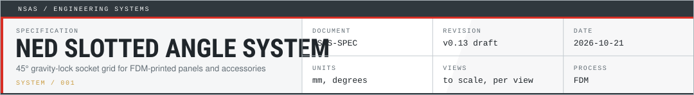
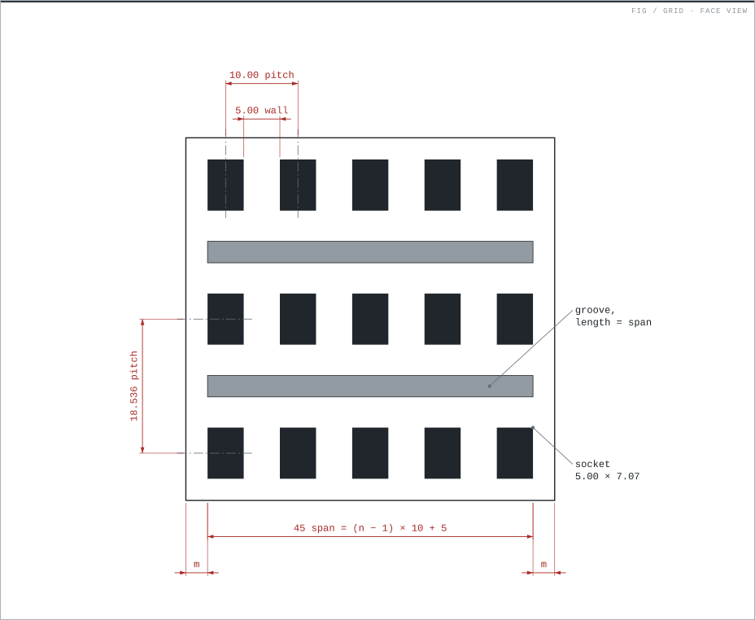
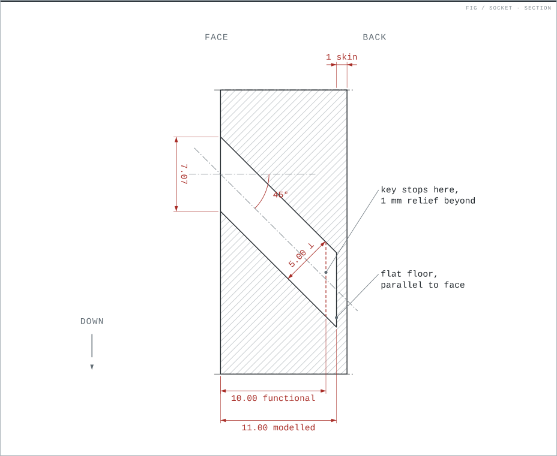

<a href="https://iamnedtan.github.io/NSAS/spec/NSAS%20Spec%20Sheet.html"></a>

<p align="right"><b><a href="https://iamnedtan.github.io/NSAS/spec/NSAS%20Spec%20Sheet.html">Open the spec sheet ▸</a></b> &nbsp;·&nbsp; <code>NSAS-SPEC</code> &nbsp;·&nbsp; <code>v0.13 draft</code> &nbsp;·&nbsp; <code>2026-10-21</code></p>

##  What it is <sub>概要</sub>

A pegboard-style mounting grid for 3D-printed panels and accessories. Panels carry a grid of 5 mm square sockets that slope 45° downward into the material, with optional angled grooves between rows. A square key joins the accessory to a socket: one straight 45° bar with a 1 mm stop, a snug split-prong leg into the panel and an expanding split-prong leg into the accessory.

The socket slopes down as it goes in, so the accessory's weight pushes the key deeper. It cannot be pulled straight out: lift and tilt to remove it. No clips or screws are needed.



##  Spec sheet <sub>仕様書</sub>

The [**illustrated spec sheet**](https://iamnedtan.github.io/NSAS/spec/NSAS%20Spec%20Sheet.html) is the reference: to-scale views of the socket, grid, groove and key, every value with its reason, and the revision history. Source: [`spec/NSAS Spec Sheet.html`](<spec/NSAS Spec Sheet.html>). The text spec is [`.claude/skills/nsas/spec.md`](.claude/skills/nsas/spec.md), the only text copy.

| Key values | | |
|---|---|---|
| Socket | `5.00` square, 45° down | `7.07` tall on the face |
| Grid | `10.00` column pitch | `18.536` row pitch, rows not staggered |
| Key | `4.60` wide, 1.0 stop | panel leg `4.6 → 5.0`, accessory leg `4.8 → 5.1` |
| Tileable margins | `2.50` side | `5.732` top and bottom |



##  Contents <sub>内容</sub>

| Path | What |
|---|---|
| [`spec/`](spec/) | Illustrated spec sheet |
| [`.claude/skills/nsas/`](.claude/skills/nsas/) | Text spec and Claude Code skill (`SKILL.md`: working summary used when adding NSAS to a design) |
| `keys/NSAS key - accessories.*` | Standard key, 1 mm stop: SolidCraft source, STEP, STL |
| `keys/NSAS key - accessories thick.*` | Thick-stop key, 3 mm stop, for accessories that must stand off the panel |
| [`keys/key_fit_test/`](keys/key_fit_test/) | Accessory-leg fit test: variant keys, test block and print plates |
| [`systems/`](systems/) | Created systems: accessory sets built on NSAS |
| [`assets/readme/`](assets/readme/) | README art, built from the spec sheet by `build.py` |

##  Created systems <sub>システム</sub>

Accessory sets built on NSAS, one folder per hobby or use. More systems, such as display bases, follow.

| System | Contents |
|---|---|
| [modelling-gunpla](systems/modelling-gunpla/) | Nipper holder, sanding block |
| [tools](systems/tools/) | Coffee cup holder (Starbucks) |

##  Printing <sub>印刷</sub>

Print keys as exported, lying on a flat side, without supports. The flat, flush side faces make this possible. See the [fit test README](keys/key_fit_test/README.md) to tune the accessory-leg fit to your printer.



##  Using the skill <sub>スキル</sub>

The `nsas` skill lets Claude Code add the grid to any panel or accessory ("use NSAS on the lid"). To use it outside this repo, link the skill folder into your user skills:

```powershell
New-Item -ItemType Junction -Path "$env:USERPROFILE\.claude\skills\nsas" -Target "E:\GIT\NSAS\.claude\skills\nsas"
```

##  History <sub>沿革</sub>

Ned ([iamnedtan](https://github.com/iamnedtan)) invented NSAS in 2026 as part of a project to remodel a plastic modelling trolley. The aim is a quick way to reconfigure and move items around, similar to a pegboard system.

The design work was first done alongside [RunnerCollector](https://github.com/iamnedtan/RunnerCollector), the first project to use NSAS. On 2026-10-21 the NSAS files moved to this repo with their git history, so the early commits here carry RunnerCollector commit messages. RunnerCollector keeps its own NSAS-based parts (the boxes and the socket broach that repairs early box prints). The nipper holder and the sanding block were copied from it into [systems/modelling-gunpla](systems/modelling-gunpla/).

##  License <sub>ライセンス</sub>

[CC BY-SA 4.0](LICENSE)


